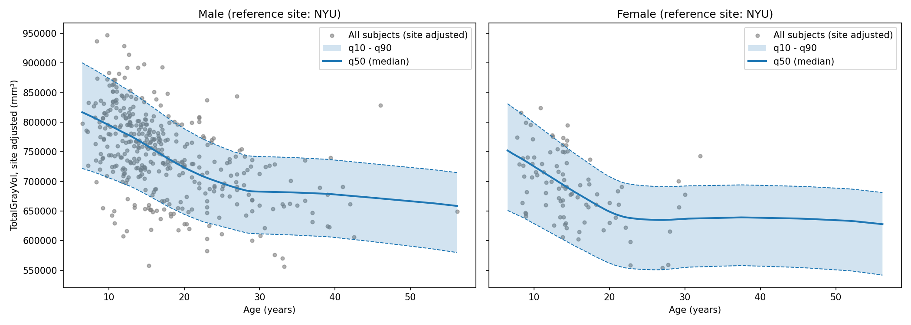
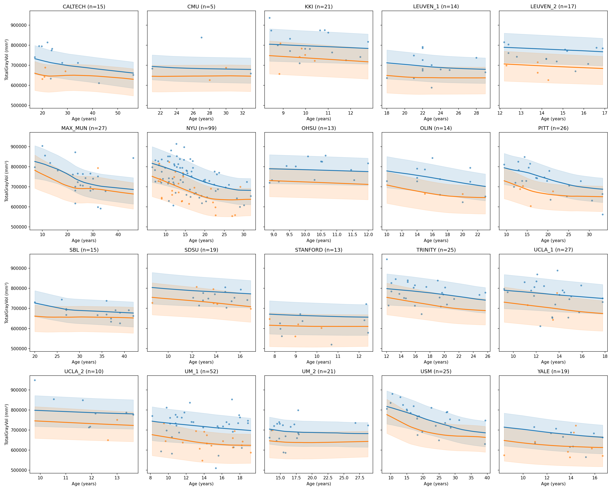

# A Deep Learning Framework for Mapping Normative Brain Development and Aging

The goal of this project is to use Quantile Regression via a Multi-Layer Perceptron to predict the 10th, 50th (median), and 90th percentiles of specific brain measurements given a subject's Age and Sex.

Instead of making a single point prediction, it estimates the variance and normative bounds of brain development, which is critical in psychiatric and neurological research for identifying individuals who deviate significantly from the population norm.

**Key findings.** Total gray matter volume showed a clear normative trajectory with age and sex, while functional connectivity showed almost no age effect. Including the acquisition site as an input, with a site-balanced split, doubled the improvement over the baseline and produced well-calibrated percentiles. These growth charts could help identify individuals whose brain structure deviates from the norm, for example in autism, ADHD and Alzheimer's disease (Chen et al., 2021).

## Data

The Autism Brain Imaging Data Exchange (ABIDE) dataset provides previously collected resting state functional magnetic resonance imaging datasets from 539 individuals with ASD and 573 typical controls for the purpose of data sharing in the broader scientific community. 


* **ABIDE:** https://fcon_1000.projects.nitrc.org/indi/abide/
* **Phenotypic data:** http://fcon_1000.projects.nitrc.org/indi/abide/abide_I.html
* **FreeSurfer outputs (ABIDE Preprocessed):** `https://fcp-indi.s3.amazonaws.com/data/Projects/ABIDE_Initiative/Outputs/freesurfer/5.1/<FILE_ID>/stats/aseg.stats`
* **Download data:** [`notebooks/preprocessing_FC.ipynb`](notebooks/preprocessing_FC.ipynb), [`notebooks/preprocessing_structural.ipynb`](notebooks/preprocessing_structural.ipynb), [`notebooks/preprocessing_structural_site.ipynb`](notebooks/preprocessing_structural_site.ipynb)
* **Retrieved data:** [`data/`](data/) (processed datasets and scaling parameters in [`data/processed/`](data/processed/))

### Preprocessing

* `preprocessing_FC`: downloads the ABIDE fMRI ROI time series (Harvard-Oxford atlas, 111 regions) of the healthy controls with Nilearn, and computes the Functional Connectivity (FC) between ROI 0 and ROI 1 (Pearson correlation, Fisher z-transformed).
* `preprocessing_structural`: downloads the FreeSurfer `aseg.stats` file of each healthy control that passed the anatomical quality control, and extracts the total gray matter volume (`TotalGrayVol`), intracranial volume and hippocampus volumes.
* `preprocessing_structural_site`: same as `preprocessing_structural`, plus the acquisition site as one-hot columns.

All preprocessing notebooks z-score Age and the target, and save the scaling parameters to transform the predictions back to original units.

## Model

`QuantileMLP`: a Multi-Layer Perceptron with a shared backbone and three outputs, the 10th, 50th and 90th percentiles.

**Non-crossing quantiles.** If each percentile is predicted independently, the network can end up with $`q_{10}`$ larger than $`q_{50}`$ (quantile crossing), which is not possible. To avoid it, the model predicts the median and two distances (increments between quantiles, as in Moon et al., 2021), made positive with Softplus:

```math
\hat{y}_{10} = \hat{y}_{50} - \text{Softplus}(\Delta_{10}) \qquad \hat{y}_{90} = \hat{y}_{50} + \text{Softplus}(\Delta_{90})
```

where $`\text{Softplus}(x) = \log(1 + e^x)`$ is always positive, so $`\hat{y}_{10} \le \hat{y}_{50} \le \hat{y}_{90}`$ always.

**Pinball loss.** Each output learns its percentile with the pinball (quantile) loss (Moon et al., 2021), for a quantile $`\tau`$ and error $`u = y - \hat{y}_{\tau}`$:

```math
L_{\tau}(u) = \max\big(\tau \cdot u, \;\; (\tau - 1) \cdot u\big)
```

For $`q_{10}`$, predicting too high costs 9 times more than too low, so about 10% of the subjects end up below it (and the same idea for $`q_{50}`$ and $`q_{90}`$).

**Training.** 70/15/15 train/validation/test split, the model with the lowest validation loss is kept. The model is compared with a baseline that ignores the inputs (same percentiles for everyone), and checked with the test set calibration (% of subjects below each percentile).

### Methods

All models use the same `QuantileMLP`, pinball loss and training loop. They differ in the target and the inputs.

* `model_FC` (Age, Sex → FC): FC growth charts have been linked to attention impairment (Kessler et al., 2016), but a single ROI pair showed almost no age effect, so the model barely improves over the baseline.
* `model_structural` (Age, Sex → `TotalGrayVol`): clear age and sex effects, but volumes differ a lot between sites (scanners), so the test set is poorly calibrated.
* `model_structural_site` (Age, Sex, Site → `TotalGrayVol`): adding the site about doubles the improvement over the baseline.
* `model_structural_site_balanced` (Age, Sex, Site → `TotalGrayVol`): same as `model_structural_site`, with the split balanced by site. Best calibration. Includes growth charts per site and for all subjects adjusted to a reference site.

## Results
## Results

**Model comparison** (test set; each model has its own test set, so the numbers are not directly comparable)

| Model | Improvement over baseline | Below q10 (expected 10%) | Below q50 (expected 50%) | Below q90 (expected 90%) |
|---|---|---|---|---|
| `model_FC` | 2.8% | 14% | 51% | 87% |
| `model_structural` | 5.7% | 26% | 66% | 96% |
| `model_structural_site` | 22.9% | 25% | 70% | 95% |
| `model_structural_site_balanced` | 18.6% | 11% | 57% | 84% |

**Key findings**

* **FC has almost no age signal** (`model_FC`): correlation with age of −0.15, so the model barely improves over the baseline (2.8%).
* **Total gray matter volume decreases with age and differs by sex** (`preprocessing_structural`, `model_structural_site_balanced`): correlation with age of −0.25 (age effect plot), the curves decrease until ~25 years, and females are ~60,000 mm³ lower than males (growth charts).
* **Site is a major source of variation** (`model_structural` vs `model_structural_site`): Age + Sex explain 20% of the variance of `TotalGrayVol`, and Age + Sex + Site 44%. Over 5 random splits, adding the site increased the improvement over the baseline from ~9% to ~18%.
* **Balancing the split by site gives the best calibration** (`model_structural_site_balanced`): 11 / 57 / 84% of the test subjects below q10 / q50 / q90, close to the expected 10 / 50 / 90%.

**Growth charts** of the best model (`model_structural_site_balanced`: Age, Sex, Site → `TotalGrayVol`, split balanced by site): all subjects, adjusted to the reference site (NYU)



Growth charts per site of the best model (`model_structural_site_balanced`), males in blue and females in orange



**Limitations**

* Small sample: 477 healthy controls, only 19% female and 29 subjects older than 30, so the curves are less reliable for females and older ages.
* The q10–q90 band is slightly narrow (73% of the test subjects inside instead of 80%), a sign of mild overfitting.
* The site is a one-hot input, so the model cannot be applied to a new site not seen during training.
* Only one brain measure (total gray matter volume) and only healthy controls were modeled.

## References

* Chen, L.-Z., Holmes, A. J., Zuo, X.-N., & Dong, Q. (2021). Neuroimaging brain growth charts: A road to mental health. *Psychoradiology*, 1(4), 272–286. https://doi.org/10.1093/psyrad/kkab022
* Kessler, D., Angstadt, M., & Sripada, C. (2016). Growth charting of brain connectivity networks and the identification of attention impairment in youth. *JAMA Psychiatry*, 73(5), 481–489. https://doi.org/10.1001/jamapsychiatry.2016.0088
* Moon, S. J., Jeon, J.-J., Lee, J. S. H., & Kim, Y. (2021). Learning multiple quantiles with neural networks. *Journal of Computational and Graphical Statistics*, 30(4), 1238–1248. https://doi.org/10.1080/10618600.2021.1909601
